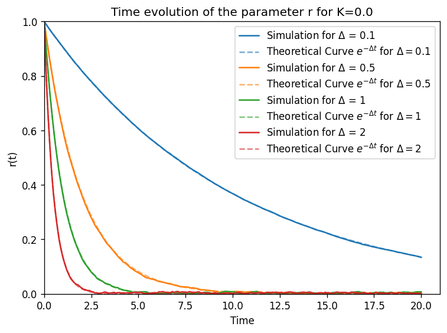
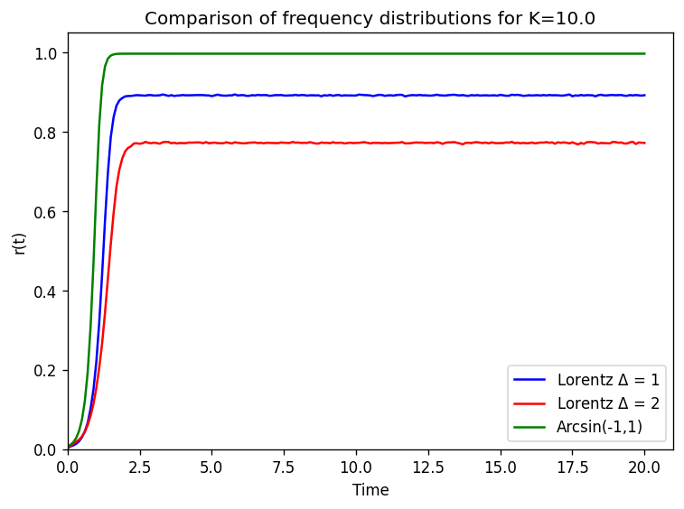
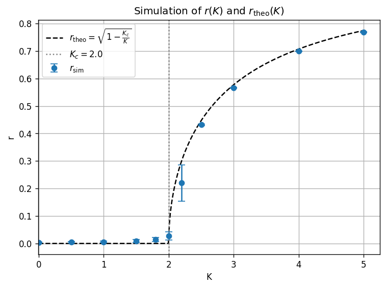
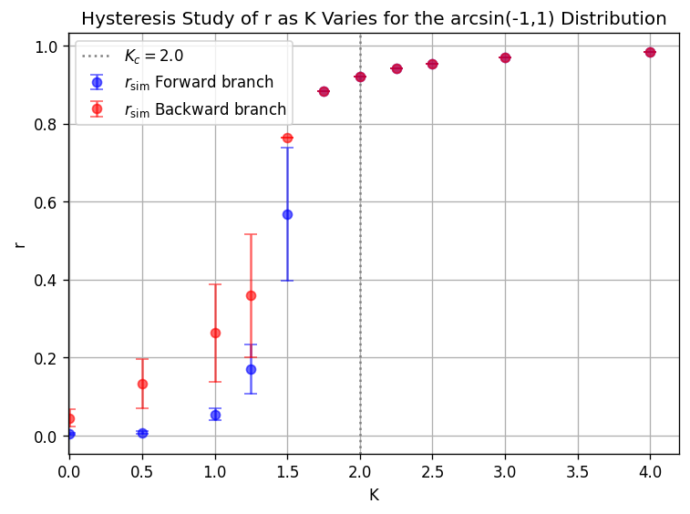

# Synchronization in the Kuramoto Model

Numerical simulations of the **Kuramoto model** to study the transition between
**incoherent** and **synchronized** states in populations of coupled oscillators,
and their comparison with analytical predictions.

How can thousands of fireflies flash in unison, or a set of metronomes end up
keeping the same beat, without a "conductor"? Each oscillator advances or delays
its internal clock, its natural frequency, until it synchronizes with the
population. Yoshiki Kuramoto's model describes this collective phenomenon with a
simple yet profound mathematical formulation.

Developed as part of my Bachelor's Thesis in Physics (*Trabajo Fin de Grado*,
University of Granada, 2025/2026). Everything needed to understand and reproduce
the results is contained in this repository.

---

## Scope of the study

- How a population of $N=5\times10^4$ oscillators with different natural
  frequencies evolves from disorder ($r\approx0$) to synchronization ($r\to1$) as
  the coupling $K$ increases.
- The role of the **natural frequency distribution** $g(\omega)$: the
  **Lorentzian** distribution (continuous, supercritical transition) is compared
  with the **arcsine** distribution arcsin(−1,1) (abrupt, subcritical transition
  with **hysteresis**).
- The verification of the simulations against exact analytical results:
  $r(t)=e^{-\Delta t}$, $r(t)=|J_0(t)|$ (where $J_0$ is the Bessel function of the
  first kind of order zero) and $r(K)=\sqrt{1-K_c/K}$.

## The model

$N$ oscillators with phases $\theta_i(t)$ and natural frequencies $\omega_i$ drawn
from $g(\omega)$, with global mean-field coupling:

```math
\dot{\theta}_i = \omega_i + \frac{K}{N}\sum_{j=1}^{N}\sin(\theta_j-\theta_i),
\qquad i=1,\dots,N.
```

The degree of synchronization is measured by the complex **order parameter**

```math
r(t)\,e^{i\Psi(t)} = \frac{1}{N}\sum_{j=1}^{N} e^{i\theta_j(t)}, \qquad 0\le r\le 1,
```

where $r$ is the phase coherence, i.e. the degree of synchronization, and $\Psi$ is
the mean phase. In terms of the order parameter, the equation can be rewritten as

```math
\dot{\theta}_i = \omega_i + K r \sin(\Psi-\theta_i),
```

which has an $O(N)$ cost per step instead of $O(N^2)$ and is the form integrated
with the **fourth-order Runge–Kutta** method.

In the limit $N\to\infty$, the self-consistency equation (the condition that $r$
must satisfy in the stationary state) yields the critical coupling, above which
synchronization emerges, and the type of bifurcation:

```math
K_c = \frac{2}{\pi\,g(0)}, \qquad
r \sim \sqrt{\frac{-16\,(K-K_c)}{\pi\,K_c^4\,g''(0)}} \quad (K\to K_c),
```

so that the sign of $g''(0)$ determines the nature of the transition:

- $g''(0)<0$ (maximum at $\omega=0$) gives a **supercritical** bifurcation: once
  $K_c$ is exceeded, $r$ grows continuously from 0.
- $g''(0)>0$ (minimum at $\omega=0$) gives a **subcritical** bifurcation: $r$
  undergoes an abrupt jump and, close to $K_c$, two stable states may coexist, one
  incoherent and one synchronized.

Two frequency distributions with opposite behaviours are studied. For the
Lorentzian, $\Delta$ is its **width**: the larger $\Delta$, the more spread out the
natural frequencies and the stronger the coupling required to synchronize. The
arcsine distribution arcsin(−1,1) has no parameters and is bounded between −1 and 1.

| Distribution | $g(\omega)$ | Sampling, $x\sim U(0,1)$ | $K_c$ | Bifurcation |
|---|---|---|---|---|
| Lorentzian | $\dfrac{\Delta}{\pi(\omega^2+\Delta^2)}$ | $\omega=\Delta\tan[\pi(x-\tfrac12)]$ | $2\Delta$ | supercritical |
| arcsin(−1,1) | $\dfrac{1}{\pi\sqrt{1-\omega^2}}$ | $\omega=\sin[\pi(x-\tfrac12)]$ | $2$ | subcritical |

## Main results

**1. Optimal simulation conditions.** The fluctuations of $r$ decrease as
$1/\sqrt{N}$; with $N=5\times10^4$ and $dt=0.1$ the simulation reproduces the theory
at an acceptable computational cost (`conditions.py`, [details](docs/02-numerical-parameters.md)).

**2. Time evolution of the order parameter $r$ from opposite initial conditions**
([details](docs/03-evolution-r.md)).

- *From the coherent to the incoherent state* ($K=0$, $r(0)=1$,
  `order_to_chaos.py`): $r(t)$ is the modulus of the Fourier transform of
  $g(\omega)$; it decays as $e^{-\Delta t}$ for the Lorentzian and oscillates as
  $|J_0(t)|$ for arcsin(−1,1).
- *From the incoherent to the coherent state* ($K=10\gg K_c$, $r(0)\approx0$,
  `chaos_to_order.py`): for the Lorentzian, $r$ saturates at
  $r_\text{sat}=\sqrt{1-2\Delta/K}$ because the "rebel" frequencies in the tails do
  not phase-lock to the group; the bounded arcsin(−1,1) distribution synchronizes almost
  completely and faster.

| From the coherent to the incoherent state | From the incoherent to the coherent state |
|:---:|:---:|
|  |  |

**3. Relation between $r$ and $K$ for two frequency distributions**
(`relation_r-k.py`, [details](docs/04-r-k-relation.md)).

- *Lorentzian:* continuous (supercritical) transition from $K_c=2\Delta$, in
  excellent agreement with $r=\sqrt{1-K_c/K}$ for $\Delta=1$ and $\Delta=2$, except
  for the point closest to $K_c$, where the system takes longer to reach the
  stationary regime.
- *arcsin(−1,1):* abrupt (subcritical) transition with **hysteresis**. The forward
  branch (increasing $K$ from the incoherent state) and the backward branch
  (decreasing $K$ from the synchronized state, with the same frequencies) do not
  coincide for $K\lesssim1.5$: two stable states coexist and the outcome depends on
  the direction in which $K$ is swept. Moreover, in the coexistence region $r$
  starts to grow below the critical value and the forward branch jumps to
  synchronization at $K\approx1.75$, **before** the theoretical $K_c=2$, which does
  not happen for the Lorentzian. This value corresponds to the frequency
  realization given by seed 12345; for other realizations the jump may occur at a
  different value of $K$ between 1.5 and 2.

| Lorentzian: supercritical transition | arcsin(−1,1): hysteresis |
|:---:|:---:|
|  |  |

### Conclusion

The simulations reproduce all the analytical predictions with high accuracy
($e^{-\Delta t}$, $|J_0(t)|$, $r_\text{sat}$ and the $r(K)$ of the Lorentzian), which
validates the implementation. The same model, changing only the natural frequency
distribution, gives rise to markedly different collective behaviours: a continuous
transition for the Lorentzian, and an abrupt transition with hysteresis for
arcsin(−1,1). **The shape of $g(\omega)$ and the value of the coupling constant $K$
determine how the system synchronizes.**

## Repository structure

| File | Content | Result |
|---|---|---|
| `functions.py` | Core: initialization of phases and frequencies, order parameter, RK4 integrator, sweeps in $K$ and plotting | — |
| `basic.py` | Minimal example: initial state, histogram of $g(\omega)$ and $r(t)$ | — |
| `conditions.py` | Convergence in $N$ and $dt$ | 1 |
| `order_to_chaos.py` | Coherent → incoherent transition ($K=0$) | 2 |
| `chaos_to_order.py` | Incoherent → coherent transition ($K\gg K_c$) | 2 |
| `relation_r-k.py` | $r(K)$ for the Lorentzian and hysteresis for arcsin(−1,1) | 3 |
| [`docs/`](docs/index.md) | Detailed documentation of each experiment: theory, implementation and results | — |

## Installation and usage

Requires Python 3 (tested with 3.13) and `numpy`, `scipy` and `matplotlib`:

```bash
pip install -r requirements.txt
```

Each script is an independent experiment:

```bash
python basic.py
python conditions.py
python order_to_chaos.py
python chaos_to_order.py
python relation_r-k.py
```

The parameters (`N`, `dt`, `T`, `k` or `k_vector`, `width`, distribution) are
defined at the beginning of each script. In `basic.py`, `order_to_chaos.py` and
`relation_r-k.py` the variable `freq` selects between `"Lorentz"` and `"Arcsin"`.
By default, `relation_r-k.py` uses `freq="Arcsin"` and produces the hysteresis
figures; for the Lorentzian $r(K)$ relation, set `freq="Lorentz"` (and choose
`width`).

**Reproducibility:** all scripts use a fixed seed (`SEED = 12345`) to generate
phases and frequencies, so every run yields identical results.

**Computational cost:** with $N=5\times10^4$, `relation_r-k.py` and the $dt$ sweep
in `conditions.py` (down to $dt=10^{-3}$) are the most expensive. For quick tests
it is enough to reduce `N`.

## References

1. J. A. Acebrón, L. L. Bonilla, C. J. Pérez Vicente, F. Ritort and R. Spigler,
   *The Kuramoto model: A simple paradigm for synchronization phenomena*,
   Rev. Mod. Phys. **77**, 137–185 (2005).
2. S. H. Strogatz, *Nonlinear Dynamics and Chaos*, Westview Press (1994).
3. T. Ferguson, *A new approach to bifurcations in the Kuramoto model*,
   J. Math. Anal. Appl. **502**, 125205 (2021).
4. J. D. da Fonseca and C. V. Abud, *The Kuramoto model revisited*,
   J. Stat. Mech. **2018**, 103204 (2018).
5. Veritasium, *The Surprising Secret of Synchronization* (2021),
   https://youtu.be/t-_VPRCtiUg.

## Author

**Pablo Antonio López Vílchez** — BSc in Physics, University of Granada.

## License

Distributed under the MIT License. See [`LICENSE`](LICENSE).
