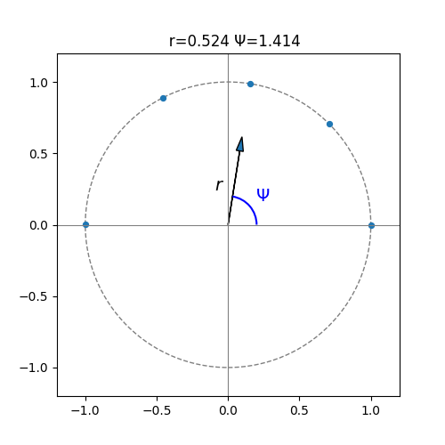
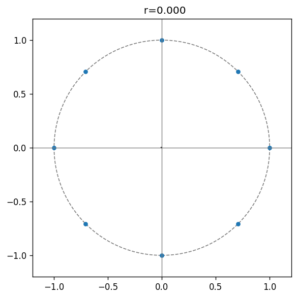
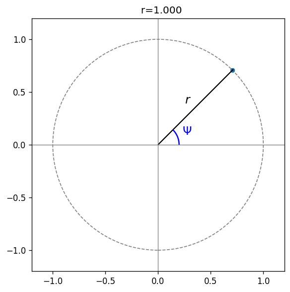
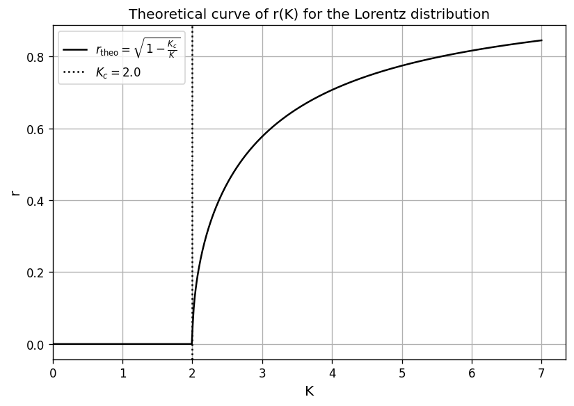
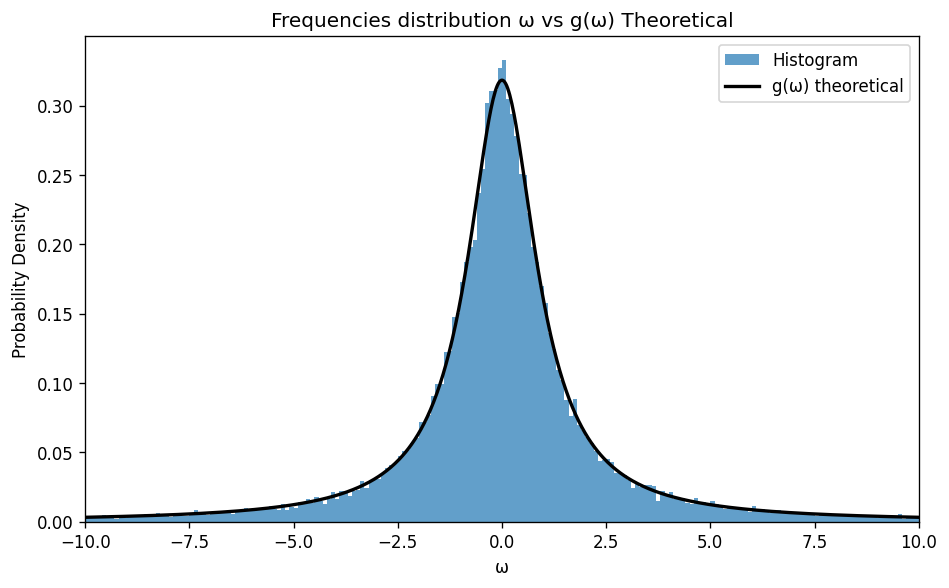
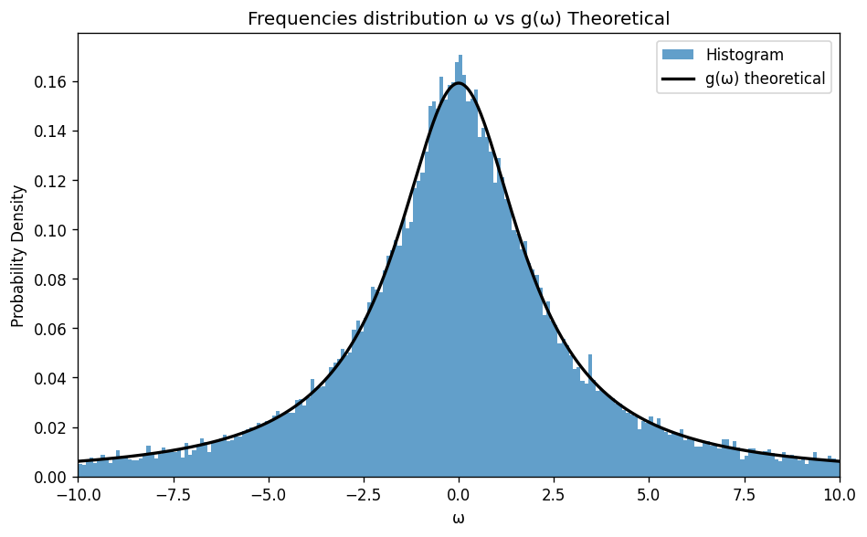
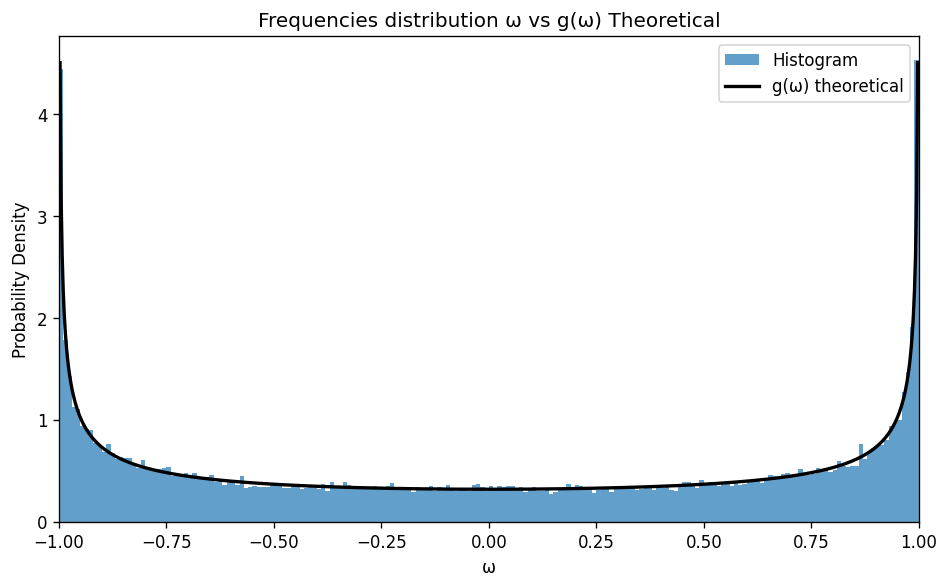

# 1. The model and the simulation

> **Files:** `functions.py` (functions module) and `basic.py` (minimal example).

## Motivation

One of the consequences of the Second Law of Thermodynamics is that systems tend
towards disorder, and the study of complex systems shows that two identical systems
with slightly different initial conditions may evolve in very different ways. One
would therefore expect nature to be disordered. Nevertheless, it displays phenomena
of a high degree of order and organization that appear to be spontaneous. How is
this possible? Possibly through the **synchronization** of the actions of the
individuals of a population.

The best-known example is that of **fireflies**: thousands of them start flashing
at random and, after some time, they all flash in unison. Each firefly delays or
advances its internal clock, its *natural frequency*, until it synchronizes with
the population. Other examples are the synchronization of **metronomes**, the
applause at the end of a concert, the heartbeat, which results from the synchronized
activity of thousands of cells, or the neurons of our brain.

In the 1970s, the Japanese physicist **Yoshiki Kuramoto** sought to understand how a
set of oscillators, elements that repeat a motion periodically such as a pendulum, a
heartbeat or an LC circuit, could synchronize without the presence of a
"conductor". His model (1975) is a simple yet profound mathematical formulation that
makes it possible to analyse synchronization as a **collective phenomenon**, richer
than the mere sum of its parts. Today it is a paradigm in statistical physics,
neuroscience, biology and engineering, and in 2025 it earned its creator the
Boltzmann Medal.

This document presents the theory of the model and the numerical tools used in the
remaining experiments.

## Theory

### The Kuramoto model

The model consists of a population of $N$ oscillators with phases $\theta_i(t)$,
whose natural frequencies $\omega_i$ are distributed according to a probability
density $g(\omega)$, and whose dynamics is governed by:

```math
\dot{\theta}_i = \frac{d\theta_i}{dt} = \omega_i + \sum_{j=1}^{N} K_{ij}\sin(\theta_j-\theta_i),
\qquad i=1,\dots,N.
```

This expression reflects how each oscillator tries to evolve independently at its
own frequency $\omega_i$, while the coupling term, given by the matrix $K_{ij}$,
tends to synchronize it with all the others.

Kuramoto's original analysis was carried out with **mean-field coupling**,
$K_{ij}=K/N$ with $K>0$. Assuming global coupling, the network structure is ignored
and all oscillators are assumed to feel the same "average" of the population:

```math
\dot{\theta}_i = \omega_i + \frac{K}{N}\sum_{j=1}^{N}\sin(\theta_j-\theta_i),
\qquad i=1,\dots,N.
```

This simplification allows the **global (complex) order parameter** to be
introduced:

```math
r(t)\,e^{i\Psi(t)} = \frac{1}{N}\sum_{j=1}^{N} e^{i\theta_j(t)},
```

where $r(t)$, with $0\le r(t)\le 1$, represents the **phase coherence**, i.e. it
measures the degree of synchronization of the oscillators, and $\Psi(t)$ is the
**mean phase**, i.e. the phase around which most oscillators are found at each
instant.

With these parameters the evolution equation can be rewritten. Using Euler's
formula, $e^{i\theta}=\cos\theta+i\sin\theta$, one has
$\sin\theta=\operatorname{Im}(e^{i\theta})$, and therefore:

```math
\dot{\theta}_l = \omega_l + \operatorname{Im}\!\left(\frac{K}{N}\sum_{j=1}^{N} e^{i\theta_j}\,e^{-i\theta_l}\right)
= \omega_l + \operatorname{Im}\!\left(e^{-i\theta_l}\,\frac{K}{N}\sum_{j=1}^{N} e^{i\theta_j}\right)
= \omega_l + \operatorname{Im}\!\left(e^{-i\theta_l}\,K\,r\,e^{i\Psi}\right),
```

where $e^{-i\theta_l}$ has been taken out of the sum and the definition of $r$ and
$\Psi$ has been identified. This yields a new description of the evolution of the
oscillators:

```math
\boxed{\dot{\theta}_i = \omega_i + K r \sin(\Psi-\theta_i)}, \qquad i=1,\dots,N.
```

This form greatly simplifies the study of the time evolution, since the order
parameters provide all the information needed about the system.

### Order parameters $r$ and $\Psi$

To understand the parameters $r$ and $\Psi$, each phase $\theta_i$ can be
represented as a point on a circle of radius 1. Then $r$ is a vector of modulus
between 0 and 1 that represents how synchronized the phases are, i.e. how close
together the points are. $\Psi$ is the angle that this vector forms with the $x$
axis and gives the global mean phase.



Two limiting situations are of particular interest:

- **Full synchronization ($r=1$).** If all phases are equal, $\theta_i=\theta$, then

  ```math
  r\,e^{i\Psi}=\frac{1}{N}\sum_{j=1}^{N}e^{i\theta}=\frac{N}{N}e^{i\theta}=1\cdot e^{i\theta},
  ```

  so that $r=1$ (maximal synchronization) and $\Psi=\theta$: the mean phase equals
  all the phases, as expected. This situation is the starting point when studying
  under which conditions the system, starting from the fully synchronized state,
  ends up in an incoherent state.

- **Incoherent state ($r=0$).** For this the phases must be equally spaced. In the
  discrete case it suffices to place them as $\theta_0=0$,
  $\theta_{i+1}=\frac{2\pi}{N}+\theta_i$. In the continuous case, they are
  distributed by an even function $f(\theta)=f(-\theta)$ that spreads them
  uniformly. In both cases, the vectors $e^{i\theta}$ in the complex plane cancel
  each other out.

| Incoherent state ($r=0$) | Full synchronization ($r=1$) |
|:---:|:---:|
|  |  |

The transition from incoherent to synchronized states, and vice versa, reflects the
relation between the order parameter $r$ and the coupling constant $K$. The jump
from the incoherent to the synchronized state occurs at a certain value of $K$, the
**critical value** $K_c$, so that $r(t)\sim0$ is expected for $K<K_c$ and $r(t)>0$
for $K>K_c$. This value can be obtained theoretically, but doing so requires the
model of many partially synchronized oscillators, i.e. taking the continuum limit
$N\to\infty$.

### The $N\to\infty$ limit. Partial synchronization

The phase domain is defined as $\theta\in[-\pi,\pi]$ and the order parameter is
rewritten by expressing the average as an integral, using the property of the Dirac
delta $\int f(x)\ \delta(x-a)\ dx=f(a)$:

```math
r\,e^{i\Psi} = \int_{-\pi}^{\pi} e^{i\theta}\left[\frac{1}{N}\sum_{j=1}^{N}\delta(\theta-\theta_j)\right]d\theta .
```

Writing the order parameter in terms of a delta function makes it possible, in the
limit $N\to\infty$, to introduce the concept of a **probability density**. The
arithmetic mean becomes an average over the phase $\theta$ and the intrinsic
frequency $\omega$:

```math
r\,e^{i\Psi} = \iint e^{i\theta} f_N(\theta,\omega,t)\,d\theta\,d\omega,
\qquad
f_N(\theta,\omega,t)=\frac{1}{N}\sum_{j=1}^{N}\delta\big(\theta-\theta_j(t)\big)\,\delta(\omega-\omega_j).
```

In the limit $N\to\infty$, the discrete distribution $f_N$ is replaced by a
continuous distribution that factorizes as
$f_N(\theta,\omega,t)\Rightarrow\rho(\theta,\omega,t)\ g(\omega)$, so that

```math
r\,e^{i\Psi} = \int_{-\pi}^{\pi}\int_{-\infty}^{\infty}
e^{i\theta}\,\rho(\theta,\omega,t)\,g(\omega)\,d\omega\,d\theta ,
```

where $g(\omega)$ is the probability density of the natural frequencies and
$\rho(\theta,\omega,t)$ is the normalized phase density for a given frequency.
Some conditions are required:

- On $g(\omega)$:
  - even about the mean, with a maximum or a minimum at 0: $g(\omega)=g(-\omega)$;
  - normalized: $\int_{-\infty}^{\infty}g(\omega)\ d\omega=1$;
  - continuous and differentiable around $\omega=0$.
- On $\rho(\theta,\omega,t)$:
  - normalized in $\theta$: $\int_{-\pi}^{\pi}\rho(\theta,\omega,t)\ d\theta=1$;
  - periodicity in the phases and parity in the frequencies:
    $\rho(\theta+\pi,-\omega,t)=\rho(\theta,\omega,t)$;
  - it must satisfy the continuity equation:
    $\dfrac{\partial\rho}{\partial t}+\dfrac{\partial}{\partial\theta}\big[\rho\ \dot\theta\big]=0$.

Following the reasoning of Acebrón *et al.* (2005), the expression of $\rho$ for the
non-trivial synchronized case is:

```math
\rho(\theta,\omega)=
\begin{cases}
\delta\!\left(\theta-\Psi-\sin^{-1}\!\left(\dfrac{\omega}{Kr}\right)\right)H(\cos\theta), & |\omega|<Kr,\\[10pt]
\dfrac{C}{|\omega-Kr\sin(\theta-\Psi)|}, & \text{otherwise},
\end{cases}
\qquad
C=\frac{\sqrt{\omega^2-(Kr)^2}}{2\pi},
```

where $\delta$ is the Dirac delta centred at $\sin^{-1}(\omega/Kr)$ for the variable
$\theta-\Psi$, $H(\cos\theta)$ is the Heaviside unit step function and $C$ is the
normalization constant. Substituting into the expression for $r$ gives:

```math
r = K r \int_{-\pi/2}^{\pi/2}\cos^2\theta\; g(Kr\sin\theta)\,d\theta .
```

This expression always has the trivial solution $r=0$, which corresponds to the
incoherent case, but also a second branch associated with partially synchronized
phases:

```math
1 = K \int_{-\pi/2}^{\pi/2}\cos^2\theta\; g(Kr\sin\theta)\,d\theta .
```

This branch is the **self-consistency equation**, which allows the transition from
$r=0$ to $r>0$ for $K>K_c$ to be studied, thereby providing an analytical expression
for $K_c$.

#### Calculation of $K_c$

$g(Kr\sin\theta)$ is expanded in a series around $r=0$, the branch of incoherent
states:

```math
g(Kr\sin\theta)=g(0)+\frac{g''(0)}{2}(Kr\sin\theta)^2+\dots
```

where $g'(0)=0$ because $g$ has a critical point at 0. Substituting into the
self-consistency equation and truncating at first order:

```math
1=K\int_{-\pi/2}^{\pi/2}\cos^2\theta\,\big[g(0)+O(r^2)\big]\,d\theta
\approx K\,g(0)\int_{-\pi/2}^{\pi/2}\cos^2\theta\,d\theta=K\,g(0)\,\frac{\pi}{2},
```

which gives the expression for the critical value, valid for any $g(\omega)$:

```math
K_c=\frac{2}{\pi\,g(0)} .
```

This is a remarkable result, since it makes it possible to know in advance whether
the system will be able to synchronize its phases simply by checking whether the
coupling constant $K$ is larger or smaller than $K_c$, and for this it suffices to
know $g(\omega)$ at 0. This holds in the supercritical case; in the subcritical case
the system may synchronize below $K_c$, as shown in [document 4](04-r-k-relation.md).

#### Analytical relation between $r$ and $K$

If the expansion is carried out to second order, the form of the relation depends on
the second derivative of $g(\omega)$:

```math
r \sim \sqrt{\frac{-16\,(K-K_c)}{\pi\,K_c^4\,g''(0)}} \qquad \text{for } K\to K_c .
```

This power law determines the type of **bifurcation** that the system will exhibit
as $K$ approaches the critical value:

- $g''(0)<0$ $\Rightarrow$ maximum at $\omega=0$ $\Rightarrow$ **supercritical bifurcation**.
- $g''(0)>0$ $\Rightarrow$ minimum at $\omega=0$ $\Rightarrow$ **subcritical bifurcation**.

### Frequency distributions

Two distributions satisfying the above conditions are used.

**Lorentzian distribution.**

```math
g(\omega)=\frac{\Delta}{\pi(\omega^2+\Delta^2)},
\qquad K_c=\frac{2}{\pi g(0)}=2\Delta ,
```

where $\Delta$ is the **width** of the distribution, the parameter that controls its
spread around $\omega=0$.

For this distribution the self-consistency equation can be solved analytically:

```math
r(K) =
\begin{cases}
0, & K \le K_c \\[4pt]
\sqrt{1-\dfrac{K_c}{K}}, & K > K_c
\end{cases}
\qquad K_c=2\Delta .
```



**Arcsine distribution arcsin(−1,1).**

```math
g(\omega)=\frac{1}{\pi\sqrt{1-\omega^2}},
\qquad K_c=2 .
```

There are several reasons for using this distribution: it satisfies the required
conditions on $g(\omega)$, it is bounded, which will be useful in some parts of the
simulation, and it satisfies $g''(0)>0$. It is therefore the "inverse" of the
Lorentzian distribution when studying the Kuramoto model: it has no tails and it has
a minimum at 0.

### Generation of the natural frequencies

During the simulation, random frequencies must be generated. To this end, a
uniformly distributed random value is transformed (`rng.uniform(0, 1, N)`, with
NumPy's fixed-seed generator, produces $N$ numbers between 0 and 1) and, through a
change of variables, $N$ numbers distributed according to the desired $g(\omega)$
are obtained.

$x$ is generated uniformly, with $f(x)=1$ and $0\le x\le1$, and the aim is to relate
it to $g(\omega)$ through $\omega=h(x)$. For this purpose, the cumulative
distributions are considered:

```math
F(x)=\int_0^x f(u)\,du=x,
\qquad
G(\omega)=\int_{-\infty}^{\omega}g(u)\,du=P(u\le\omega).
```

Both are random variables in $[0,1]$ and satisfy $G(\omega)=F(x)=x$. Defining
$\omega=h(x)$, i.e. $x=h^{-1}(\omega)$:

```math
G(\omega)=F(x)=F\big(h^{-1}(\omega)\big)=F\big(h^{-1}(h(x))\big)=F(x)=x ,
```

which yields a direct relation between $G(\omega)$, computed from $g(\omega)$, and
the random variable $x$:

```math
\omega=G^{-1}(x).
```

| Distribution | $G(\omega)$ | $\omega = G^{-1}(x)$ |
|---|---|---|
| Lorentzian | $\dfrac{1}{\pi}\arctan\left(\dfrac{\omega}{\Delta}\right)+\dfrac12$ | $\Delta\tan\left[\pi\left(x-\tfrac12\right)\right]$ |
| arcsin(−1,1) | $\dfrac{1}{\pi}\arcsin\omega+\dfrac12$ | $\sin\left[\pi\left(x-\tfrac12\right)\right]$ |

## Implementation

### How the simulation works

The synchronization of the oscillators is simulated with the **fourth-order
Runge–Kutta** method (RK4), which provides the numerical solution of a differential
equation. In the Kuramoto model there are two equations describing the time
evolution of the system:

```math
\dot{\theta}_i=\omega_i+\frac{K}{N}\sum_{j=1}^{N}\sin(\theta_j-\theta_i)
\qquad\text{and}\qquad
\dot{\theta}_i=\omega_i+K r\sin(\Psi-\theta_i).
```

- The first is the most basic one, without the concept of order parameters. Owing to
  the sum over $j$, its computational cost is of order $O(N^2)$. In addition, $r$
  and $\Psi$ must be computed at every time step, which further increases the cost.
- The second takes advantage of the fact that $r$ and $\Psi$ are computed at every
  time step and is of order $O(N)$.

Since the simulations aim to approximate the limit $N\to\infty$, using the second
equation reduces the computation time considerably. After each step the phases are
reduced to $[0,2\pi)$.

The following variables appear in the simulations:

- the number of oscillators: $N$;
- the time step of the RK4 method: $dt$;
- the total evolution time of the system: $T$;
- the initial condition on the phases: $\theta_i(t=0)$;
- the type of distribution and its parameters: $g(\omega)$ and $\Delta$;
- the value or values of the coupling constant: $K$.

In general $N$, $dt$ and $T$ are kept constant. $T$ is increased or decreased in some
cases for computational reasons or because the system has already reached a
saturated state. The different results are obtained mainly by varying the initial
conditions on the phases or the natural frequencies and the value of the coupling
constant. The whole study focuses on the **order parameter $r$**, owing to its
central role in the model.

To simplify the simulations, the code is split into a **functions module** and
several **main scripts**. The functions module initializes frequencies and phases,
computes the order parameters, evolves the system and stores the values of $r$ to
compute its mean. Each main script simulates a specific experiment. In this way the
same experiment can be repeated with other frequencies, with other initial
conditions or, with a simple vector, with different values of the coupling constant.

### `functions.py`

| Function | Description |
|---|---|
| `n_steps(T, dt)` | Number of stored time points so that the evolution covers $[0,T]$. |
| `initialize(N, width, initial_phase, frequency, rng)` | Initializes the phases and frequencies and returns `theta0` and `omega`. `initial_phase=0` gives random phases in $[-\pi,\pi)$ ($r\approx0$) and `initial_phase=1` sets all of them to $\pi/4$ ($r=1$). `frequency` can be `"Lorentz"` or `"Arcsin"` (the latter does not use `width`), and `rng` is the fixed-seed random generator, for reproducibility. |
| `parameter(theta)` | Returns $(r,\Psi)$ as the modulus and argument of `mean(exp(1j*theta))`. |
| `kuramoto_parameter_eq(theta, omega, k)` | Right-hand side of the equation in terms of the order parameters, of order $O(N)$. |
| `evolution_parameter(theta0, omega, k, dt, steps)` | Time evolution with RK4 for a fixed $K$. Returns $r(t)$, $\Psi(t)$ and the final phases. |
| `evolution_variable_k(theta0, omega, k_vector, dt, steps, t_discard, continuation)` | Repeats the evolution for each $K$ in `k_vector` and computes the mean and standard deviation of $r$ in the stationary regime ($t\ge$ `t_discard`). With `continuation=True`, each $K$ starts from the final phases of the previous one. |
| `plot_phases_static`, `plot_frequency`, `plot_r_t` | Plot the phases on the circle, the histogram of $\omega$ against $g(\omega)$ (`plot_frequency(omega, frequency, width)` draws the theoretical curve of the given distribution) and the evolution $r(t)$. |

The core of the integrator:

```python
def kuramoto_parameter_eq(theta, omega, k):
    r, psi = parameter(theta)
    return omega + k * r * np.sin(psi - theta)

# one RK4 step
k1 = kuramoto_parameter_eq(theta, omega, k)
k2 = kuramoto_parameter_eq(theta + 0.5*dt*k1, omega, k)
k3 = kuramoto_parameter_eq(theta + 0.5*dt*k2, omega, k)
k4 = kuramoto_parameter_eq(theta + dt*k3, omega, k)
theta = np.mod(theta + dt/6*(k1 + 2*k2 + 2*k3 + k4), 2*np.pi)
```

In the inverse transform for the Lorentzian, $x$ is clipped to $[10^{-12},\ 1-10^{-12}]$ with
`np.clip` to avoid problems with the tangent at 0 and 1.

### `basic.py`

Baseline simulation with the Lorentzian ($\Delta=1$, $K=3$, $N=5\times10^4$,
$T=50$). It starts from the fully synchronized state ($r=1$), shows the initial
situation and the frequency histogram, and plots the evolution of $r(t)$. Since
$K=3>K_c=2$, the system does not fully desynchronize: $r$ decreases to the
stationary value $\sqrt{1-2/3}\approx0.58$.

Other cases can be explored simply by changing the variables at the beginning of the
script: `freq` (`"Lorentz"` or `"Arcsin"`), `width` (the width $\Delta$, not used by
the arcsine distribution), `k`, `N` or `T`. The three histograms in this document
are obtained with `width=1.0`, with `width=2.0` and with `freq="Arcsin"`.

## Results

The frequencies generated with the change of variables are shown as histograms,
together with the theoretical $g(\omega)$ of each distribution.

| Lorentzian, $\Delta=1$ | Lorentzian, $\Delta=2$ | arcsin(−1,1) |
|:---:|:---:|:---:|
|  |  |  |

**Lorentzian distribution.** The first two plots show the Lorentzian distribution
for two values of the width $\Delta$:

- For $\Delta=1.0$, the distribution is narrower and has a sharper peak.
- For $\Delta=2.0$, the distribution broadens, the central peak decreases and the
  spread increases.

As $\Delta$ increases, the distribution becomes more spread out around $\omega=0$,
with heavier tails and a less dominant peak. This implies a greater diversity of
natural frequencies among the oscillators of the Kuramoto model, which **will hinder
synchronization**.

**Arcsine distribution.** The third plot shows the arcsin(−1,1) distribution: it is
defined on $(-1,1)$, has no tails and has a minimum at $\omega=0$.

The comparison of the simulation with the analytical results for the evolution of
the system is presented in documents [3](03-evolution-r.md) and
[4](04-r-k-relation.md).

## How to reproduce

```bash
python basic.py
```

It takes a few seconds. The figures illustrating the order parameter and the
theoretical $r(K)$ curve are static images and are not generated by any script.
