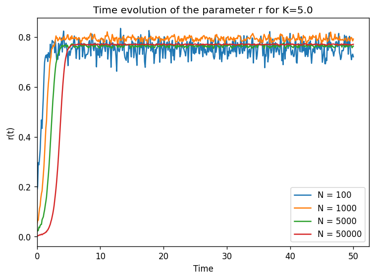
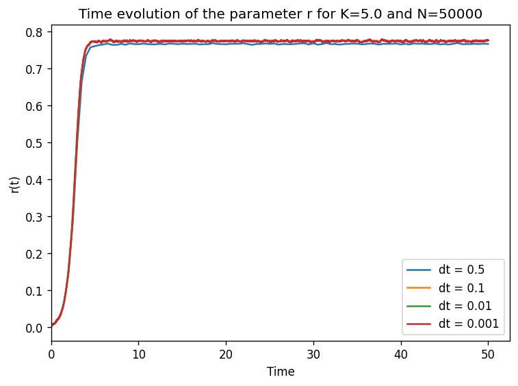

# 2. Optimal simulation conditions: choice of $N$ and $dt$

> **File:** `conditions.py`

## Motivation

Under which conditions must the simulations be run in order to reproduce what
Kuramoto's theory predicts? To answer this, the same experiment is simulated for
different values of a parameter and, by comparing them, a value is chosen that
faithfully reproduces the theoretical expectation without an excessive
computational cost. The values fixed here are used in all subsequent experiments.

## Theory

**Number of oscillators $N$.** In the theory, concepts such as the critical value
$K_c$, the analytical relation $r(K)$ or the very study of synchronization are
defined in the limit $N\to\infty$. In the simulation, $N$ must be given a value that
approximates this limit without an excessive computational cost.

If $N$ is too small, even when starting from fully random initial conditions it is
very likely that **small random groups of oscillators with similar phases** will be
present. These groups cause $r(t)$ to grow and not to faithfully follow the theory,
which could lead to spurious results, for instance when determining $K_c$ from the
variation of $r$. Moreover, the deviation of the parameter $r$ decreases as

```math
\delta r \sim \frac{1}{\sqrt{N}} ,
```

so the more oscillators there are, the smaller the fluctuations around the
synchronized state.

**Time step $dt$.** This parameter is not intrinsic to the Kuramoto model, but to the
integration method used to solve the differential equation (fourth-order
Runge–Kutta). The value of $dt$ controls the accuracy of the integration:

- a step that is too large introduces accumulated errors and may distort both the
  transient regime (the interval during which $r$ evolves) and the stationary
  regime (the interval in which $r$ has already stabilized);
- a step that is too small greatly increases the computational cost without
  significantly improving the accuracy, and may even produce spurious values.

## Implementation

The Lorentzian distribution with $\Delta=1$ ($K_c=2$) is simulated, starting from the
incoherent state and with a coupling **$K=5>K_c$**. A single parameter is varied at a
time:

| Sweep | Values | Fixed |
|---|---|---|
| Number of oscillators | $N\in\lbrace 100,\ 1000,\ 5000,\ 50000 \rbrace$ | $K=5$, $dt=0.1$, $T=50$ |
| Time step | $dt\in\lbrace 0.5,\ 0.1,\ 0.01,\ 0.001 \rbrace$ | $K=5$, $N=50000$, $T=50$ |

**Why $K>K_c$?** For $K<K_c$ the system remains in the incoherent state and $r(t)$
only shows noise around zero. By contrast, for $K>K_c$, $r(t)$ has a transient regime and
a stationary regime with a theoretically known value, $r=\sqrt{1-K_c/K}\approx0.77$.
This makes it immediately visible whether a small $N$ adds fluctuations or a large
$dt$ distorts the curve.

For each case, `initialize` and `evolution_parameter` are called and the $r(t)$
curves are superimposed. In the $dt$ sweep, all curves start from the same phases
and frequencies, so that they differ only in the time step. Since the number of
steps (`n_steps(T, dt)`, i.e. $T/dt+1$ time points covering $[0,T]$) changes with
each value, the results are stored in lists.

## Results

**Variation of $N$.** For $K>K_c$, $r>0$ is expected, and all cases satisfy this, but
the fluctuations are very different:

- for $N=100$ the fluctuations are too large and the results are unreliable;
- for $N=1000$ they are still visible, and the stationary value lies somewhat above
  the theoretical one ($\approx0.80$ versus $0.77$);
- for $N=5000$ the expectation is met, and for $N=50000$ there is a clear reduction of
  the fluctuations of $r$, which stabilizes at $r\approx0.77$.



**Variation of $dt$.** Even with a relatively large time step such as $dt=0.1$, the
evolution of $r(t)$ faithfully reproduces the behaviour expected for $K>K_c$. The
curve is indistinguishable from those obtained with smaller steps, such as $dt=0.01$
or $dt=0.001$, in both the transient and the stationary regime. Only $dt=0.5$
deviates slightly, with a somewhat lower stationary value.



**Conclusion.** The fluctuations around the synchronized state arise because the
deviation of the parameter $r$ decreases as $\sim1/\sqrt{N}$. For this reason, and to
keep the computational cost moderate, the simulations are carried out with
$N=50000$. On the other hand, a time step that is too small greatly increases the
computational cost, especially for large system sizes such as $N=50000$ and long
simulation times such as $T=100$, which will be used later, and $dt=0.1$ shows no
significant deviations. For these reasons, the remaining simulations use

```math
N = 50000, \qquad dt = 0.1 ,
```

which represent the model satisfactorily at an acceptable computational cost.

## How to reproduce

```bash
python conditions.py
```

The full script takes about 11 minutes. The slowest part is the $dt$ sweep: with
$dt=0.001$ there are $5\times10^4$ RK4 steps over $5\times10^4$ oscillators.
