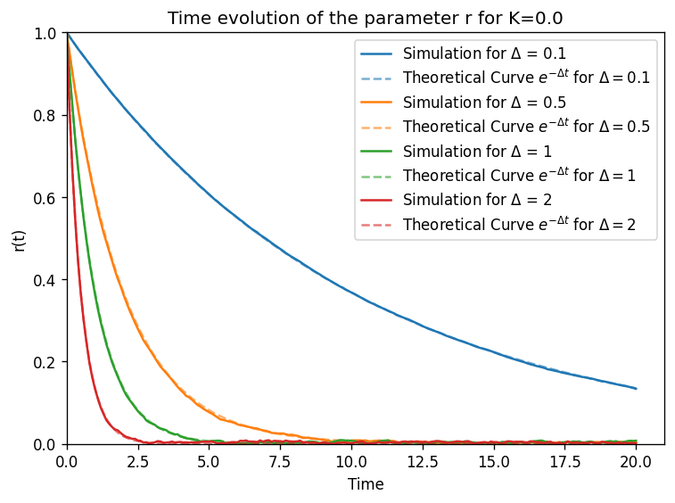
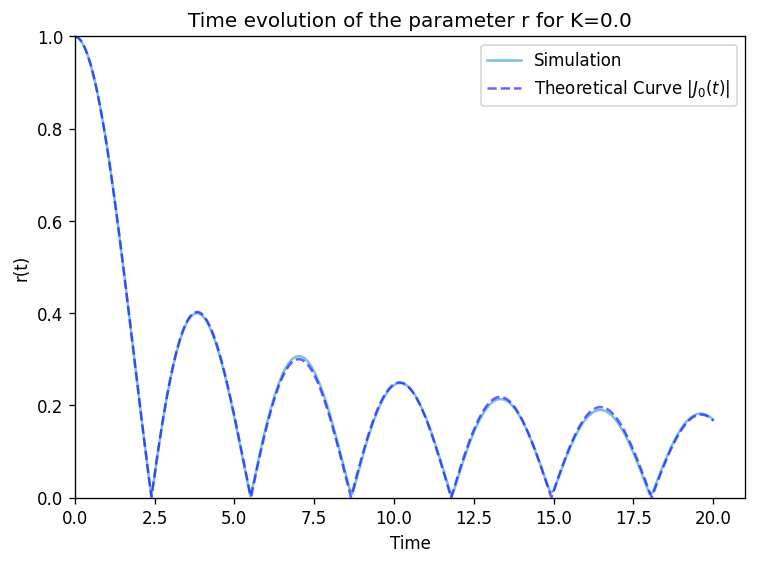
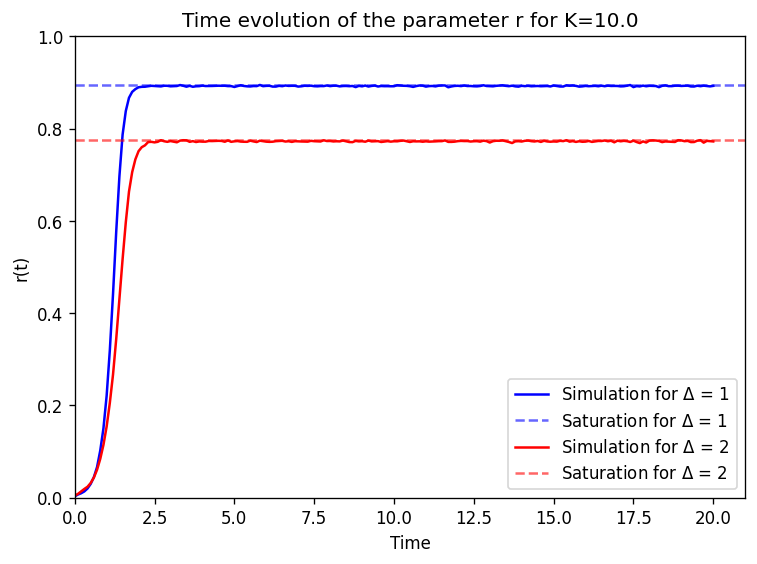
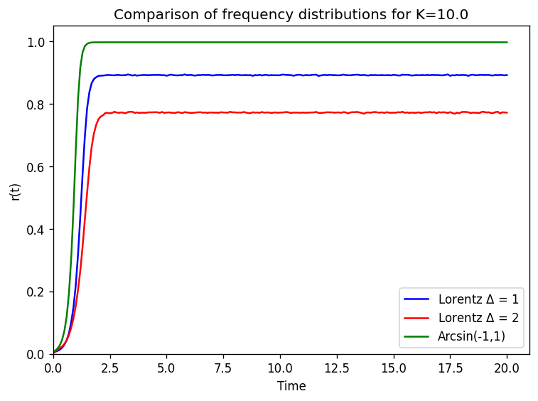

# 3. Study of the evolution through the order parameter $r$

> **Files:** `order_to_chaos.py` (case A) and `chaos_to_order.py` (case B)

## Motivation

The time evolution of the system is studied, together with how to distinguish
between its two states:

- **Incoherent state.** The system appears completely random and independent, and the
  phases of the oscillators show no apparent relation: $r\sim0$.
- **Coherent or synchronized state.** The system of $N$ oscillators behaves as a
  single one, because all of them are synchronized: $r\sim1$.

Returning to the evolution equation,

```math
\dot{\theta}_i=\omega_i+K r\sin(\Psi-\theta_i),
```

it can be seen that the coupling enters through the **product $Kr$**, and this is
what determines whether or not the phases synchronize:

- if $K\le K_c$, the system does not have enough "interaction" and the coupling is
  not sufficient to synchronize the oscillators;
- if $K\ge K_c$, the system has enough "interaction" and the effects of the coupling
  begin to appear.

The two limiting cases are studied, comparing in both the Lorentzian and the
arcsin(−1,1) distributions:

| Case | Initial state | Coupling | Question addressed |
|---|---|---|---|
| **A. From the coherent to the incoherent state** | fully synchronized, $r(0)=1$ | $K=0$ | How is synchronization lost? |
| **B. From the incoherent to the coherent state** | incoherent, $r(0)\approx0$ | $K=10\gg K_c$ | To what extent and how fast does the system synchronize? |

Case A also has an analytical solution, so it serves to **verify** that the
simulation reproduces the theory.

## Theory

### A. Transition from the coherent to the incoherent state

If the product $Kr=0$ is achieved by setting $K=0$ and fixing $r=1$, the system
starts from the fully synchronized state and the evolution equation becomes:

```math
\dot{\theta}_i=\omega_i \quad\Longrightarrow\quad \theta_i(t)=\omega_i t+\theta_i(0).
```

This equation is interpreted as follows: the oscillators rotate with angular
frequencies given by their own natural frequencies. To start with $r=1$, all initial
phases are set to the same angle, $\theta_i(0)=\theta(0)$. As the system evolves, the
population spreads according to the frequency distribution $g(\omega)$, which, being
symmetric, centred at 0 and of zero mean, causes the phases to end up uniformly
distributed in $[-\pi,\pi]$.

Analytically, in the limit $N\to\infty$:

```math
r\,e^{i\Psi}=\frac{1}{N}\sum_{j=1}^{N}e^{i\theta_j}
\;\xrightarrow{N\to\infty}\;
\int_{-\pi}^{\pi}\int_{-\infty}^{\infty}e^{i\theta}\rho(\theta,\omega,t)\,g(\omega)\,d\omega\,d\theta .
```

For $K=0$ and $r(0)=1$, the phases no longer have an independent distribution, but
are distributed as $\theta_i(t)=\omega_i t$, taking $\theta(0)=0$, since a phase
shift common to all phases does not change $r$. This allows one to write
$\rho(\theta,\omega,t)=\delta(\theta-\omega t)$ and to compute the order parameter as
an average over the frequencies:

```math
r\,e^{i\Psi}=\int_{-\pi}^{\pi}\int_{-\infty}^{\infty}e^{i\theta}\,\delta(\theta-\omega t)\,g(\omega)\,d\omega\,d\theta
=\int_{-\infty}^{\infty}e^{i\omega t}\,g(\omega)\,d\omega .
```

Taking the modulus:

```math
r(t)=\left|\int_{-\infty}^{\infty}e^{i\omega t}\,g(\omega)\,d\omega\right| ,
```

which is the modulus of the **Fourier transform of the frequency distribution**.
Going one step further:

```math
\int_{-\infty}^{\infty}e^{i\omega t}g(\omega)\,d\omega
=\int_{-\infty}^{\infty}\cos(\omega t)\,g(\omega)\,d\omega
+i\int_{-\infty}^{\infty}\sin(\omega t)\,g(\omega)\,d\omega .
```

On the interval $(-\infty,+\infty)$, the cosine term is even·even = even and the sine
term is odd·even = odd, so the second integral vanishes.

**Lorentzian distribution.** In this case:

```math
r(t)=\int_{-\infty}^{\infty}\cos(\omega t)\,\frac{\Delta}{\pi(\omega^2+\Delta^2)}\,d\omega ,
```

an integral that can be evaluated either through the Fourier transform or with the
Residue Theorem:

```math
r(t)=e^{-\Delta t}.
```

This expression satisfies $r(0)=1$ and, for $t>0$, $r$ decays exponentially with a
time constant $\tau=1/\Delta$.

**Arcsine distribution arcsin(−1,1).** In this case:

```math
r(t)=\int_{-1}^{1}\cos(\omega t)\,\frac{1}{\pi\sqrt{1-\omega^2}}\,d\omega .
```

This integral is related to the Bessel functions. With the change of variables
$\omega=\cos x$, $d\omega=-\sin x\ dx$ and $\sqrt{1-\omega^2}=\sin x$:

```math
r(t)=\int_{\pi}^{0}\frac{\cos(t\cos x)}{\pi\sin x}(-\sin x)\,dx
=\frac{1}{\pi}\int_0^{\pi}\cos(t\cos x)\,dx=J_0(t),
```

which is the integral representation of the **Bessel function of the first kind of
order zero**. This function starts at $J_0(0)=1$, oscillates, and its amplitude
decreases as $t$ increases. Since $r\ge0$, the quantity compared with the simulation
is $|J_0(t)|$.

### B. Transition from the incoherent to the coherent state

The case in which the coupling term $Kr\sin(\Psi-\theta_i)$ dominates is now
studied, taking $K\to\infty$. The system starts from the incoherent state ($r=0$),
with random initial phases. Studying the fixed points of the system,
$\dot\theta=0$:

```math
\theta=\Psi+\arcsin\!\left(\frac{\omega}{Kr}\right)
\;\xrightarrow{K\to\infty}\;
\theta=\Psi+\arcsin(0)=\Psi .
```

That is, when $K\to\infty$ the coupling **"locks" the phases** of the oscillators at
$\Psi$, which represents the global mean phase.

For the Lorentzian distribution, the analytical relation between $r$ and $K$ is known:

```math
r(K)=\sqrt{1-\frac{K_c}{K}}=\sqrt{1-\frac{2\Delta}{K}}\qquad\text{for } K>K_c .
```

This equation describes how $r$ changes as $K$ varies. For a fixed $K$, even in the
limit $K\gg K_c$, there is a **saturation** intrinsic to the system that can be
computed theoretically from $\Delta$ and $K$. For $K=10$:

```math
\Delta=1.0\ \Rightarrow\ r_\text{sat}=\sqrt{1-\tfrac{2\cdot1}{10}}\approx0.89,
\qquad
\Delta=2.0\ \Rightarrow\ r_\text{sat}=\sqrt{1-\tfrac{2\cdot2}{10}}\approx0.77 .
```

## Implementation

Both scripts use `initialize` and `evolution_parameter` from `functions.py`. Only the
initial condition, the coupling and the theoretical curve used for comparison
change.

| Parameter | A. `order_to_chaos.py` | B. `chaos_to_order.py` |
|---|---|---|
| $K$ | 0 | 10 |
| Initial condition | `initial_phase=1` (all phases at $\pi/4$, $r=1$) | `initial_phase=0` (random phases, $r\approx0$) |
| Distributions | Lorentzian $\Delta\in\lbrace 0.1,\ 0.5,\ 1,\ 2 \rbrace$, or arcsine (according to `freq`) | Lorentzian $\Delta=1$ and $\Delta=2$, and arcsine |
| Theoretical curve | `np.exp(-w*t)` and `np.abs(scipy.special.j0(t))` | horizontal line at $r_\text{sat}$ |
| Common | $N=50000$, $dt=0.1$, $T=20$ | |

## Results

### A. From the coherent to the incoherent state

**Lorentzian distribution.** The simulation results are practically identical to the
theoretical expectation. This verifies that the simulation model is sufficiently
accurate and satisfactorily reproduces the theoretical results.



The exponential relation between the decay of $r$ and the width of the distribution
is clearly observed. The time taken by $r$ to reach $\sim0$ is inversely proportional
to $\Delta$: the larger the width, the faster the system reaches the incoherent
state. At the opposite extreme, for $\Delta=0.1$, $r$ decays much more slowly: at
$t=20$ it is still $e^{-2}\approx0.14$.

This inverse relation can be understood by qualitatively examining the limiting case.
If $g(\omega)$ had $\Delta\sim0$, it would be a Dirac delta centred at some value
$\omega_0$, and all oscillators would share the same dynamics, $\theta_i=\omega_0 t$.
Starting from the same initial condition, $r=1$, they would all evolve identically
and remain at $r=1$.

**Arcsine distribution.** The simulation again faithfully reproduces the theory, even
when the type of frequency distribution is changed.



There is now no complete decay towards $r\sim0$, but rather an **oscillatory
behaviour** over time, which is due to the type of $g(\omega)$, as shown by the
equations. Two phenomena should be highlighted:

- $r$ oscillates between maxima and minima, and the minima are always at $r=0$;
- the amplitude of the maxima decays as the system evolves.

### B. From the incoherent to the coherent state

**Saturation for the Lorentzian.** Even in the limit $K\gg K_c$, there is a
saturation of the maximum value of $r$, represented by the dashed lines. The
simulation agrees with the theoretical $r_\text{sat}$ for each width.



This simulation allows two regimes to be defined in the time evolution of $r$:

- the **transient regime**, in which the system evolves;
- the **stationary regime**, in which the value of $r$ stabilizes and which is used
  later, for instance to compute its mean or its standard deviation.

**Lorentzian versus arcsine.** The three distributions are compared at the same
$K=10$: the Lorentzian with $\Delta=1$, the Lorentzian with $\Delta=2$ and
arcsin(−1,1). The most relevant feature of this comparison is that the arcsin(−1,1)
distribution does not appear to saturate ($r\approx1$) and reaches the stationary
regime earlier. The two Lorentzian curves lie below it, the more so the larger the
width.



The explanation is that the arcsin(−1,1) distribution generates frequencies $\omega$
that are neither too large nor too small. Its tails are bounded, since it is defined
on $(-1,1)$, and this facilitates the synchronization of the phases. With
$K=10\gg K_c=2$, it is relatively easy for all oscillators to be attracted by the
group, thereby phase-locking them.

In the Lorentzian distribution, on the other hand, the frequencies are unbounded, and
there may be oscillators with **"rebel" frequencies** in the tails. The group term
$Kr$ is unable to attract them, so they oscillate independently without feeling the
coupling of the group.

## Comparison and consequences

- **The shape of $g(\omega)$ governs the dynamics in both directions.**
  - The Lorentzian has tails: it loses coherence exponentially and never fully
    synchronizes.
  - The arcsine distribution is bounded: while losing coherence it oscillates, and
    when synchronizing it reaches almost $r=1$.
- **Transient and stationary regimes.** Because of this distinction, in
  [document 4](04-r-k-relation.md) $r(K)$ is computed by averaging $r$ only from a
  time `t_discard` onwards, once the stationary regime has been reached.
- **Oscillations of the arcsine distribution.** The fact that, for the arcsine
  distribution, there is no complete decay but oscillations between maxima and $r=0$
  will cause certain "problems" when studying the mean value of $r$ in the
  stationary regime for $K<K_c$. Knowing this explains why some values of $r(K)$
  show a larger deviation than the rest.

## How to reproduce

```bash
python order_to_chaos.py
python chaos_to_order.py
```

In `order_to_chaos.py`, the variable `freq` selects `"Lorentz"` or `"Arcsin"`. Each
script takes less than a minute.
