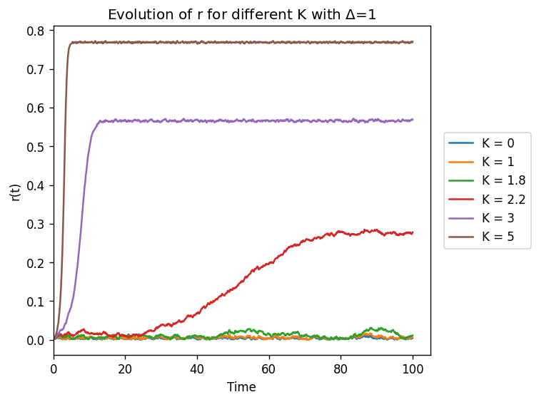
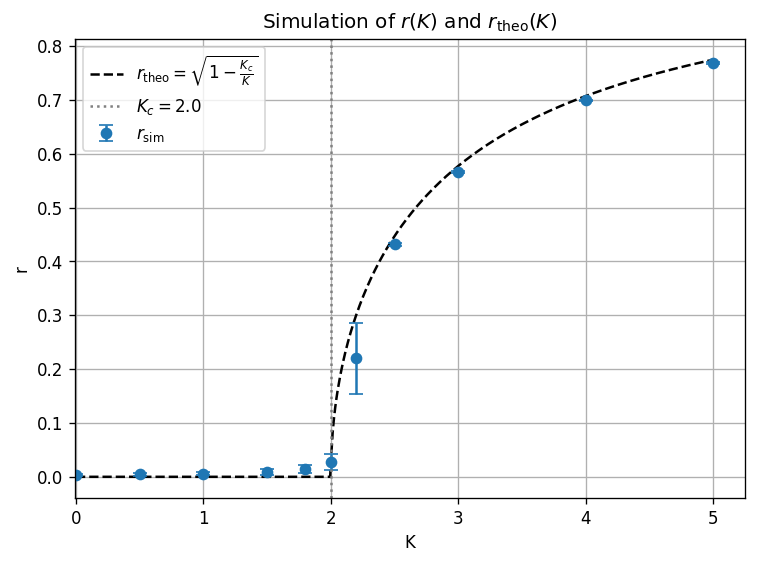
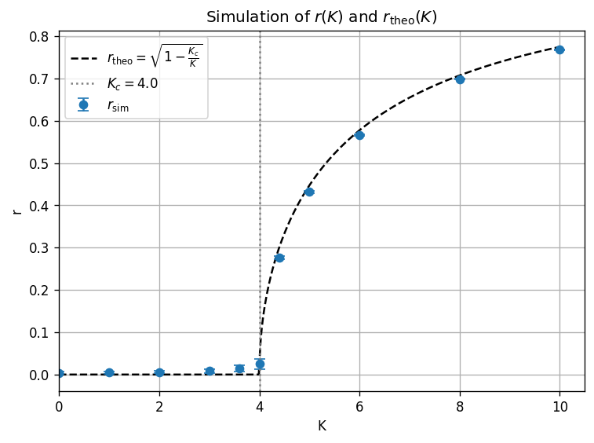
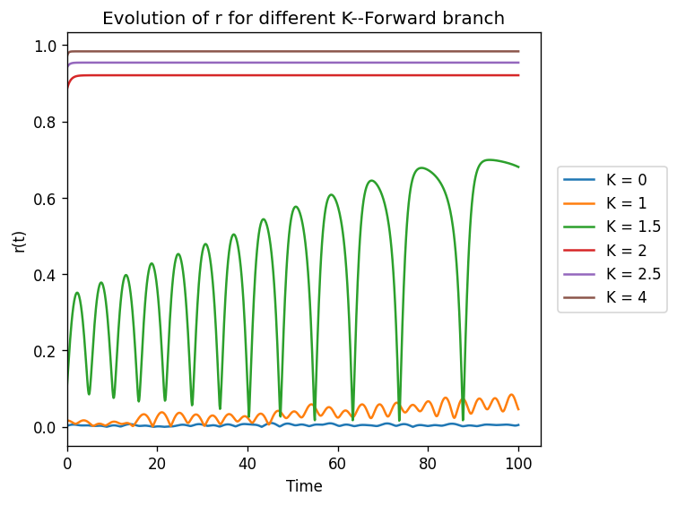
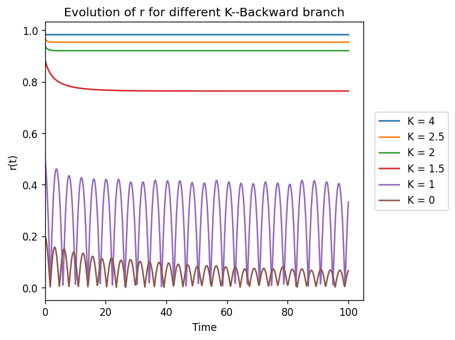
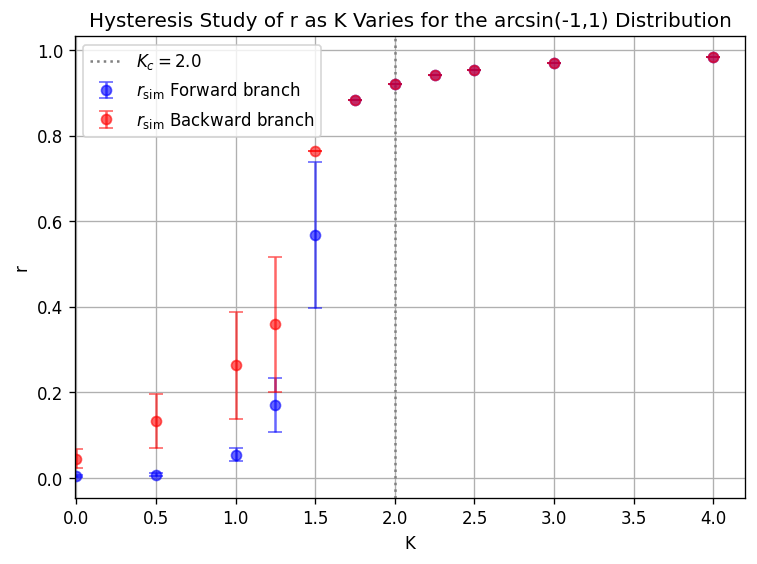

# 4. Study of the relation between the order parameter $r$ and the coupling $K$

> **File:** `relation_r-k.py` (`freq = "Lorentz"` or `freq = "Arcsin"`)

## Motivation

In [document 3](03-evolution-r.md) the coupling $K$ was kept fixed. Now $K$ becomes a
variable, in order to examine what happens to $r$ and the role of the critical value
$K_c$ in the behaviour of the system. In the limit $N\to\infty$, the relation between
$r$ and $K$ is given by the self-consistency equation, which can be solved in certain
cases. To study it, the time evolution of $r$ is followed, now for different values of
$K$, with two frequency distributions:

| Distribution | Shape at $\omega=0$ | $K_c$ | Prediction |
|---|---|---|---|
| **A. Lorentzian** | maximum, $g''(0)<0$ | $2\Delta$ | **supercritical** transition, with an analytical relation $r(K)$ |
| **B. arcsin(−1,1)** | minimum, $g''(0)>0$ | $2$ | **subcritical** transition, with **hysteresis** |

## Theory

From [document 1](01-model.md), the critical value and the power law close to it are:

```math
K_c=\frac{2}{\pi g(0)},\qquad
r \sim \sqrt{\frac{-16\,(K-K_c)}{\pi\,K_c^4\,g''(0)}}\quad (K\to K_c).
```

The sign of $g''(0)$ determines the type of bifurcation.

### A. Lorentzian distribution: supercritical bifurcation

The self-consistency equation has an analytical solution:

```math
r(K) =
\begin{cases}
0, & K \le K_c \\[4pt]
\sqrt{1-\dfrac{K_c}{K}}, & K > K_c
\end{cases}
\qquad K_c=2\Delta .
```

Since $g''(0)<0$, the transition is **supercritical**: the order parameter grows
smoothly and continuously from zero when $K>K_c$. This type of transition is
characteristic of smooth unimodal distributions such as the Lorentzian.

Since $K_c=2\Delta$, changing the width shifts the onset of the transition and
modifies the shape of the curve $r(K)$. A larger width implies more widely spread
natural frequencies and, consequently, a stronger coupling is required to synchronize
the system.

### B. Arcsine distribution arcsin(−1,1): subcritical bifurcation

For this distribution there is no analytical relation such as the one obtained for
the Lorentzian. Moreover, $g''(0)>0$, so the bifurcation is **subcritical** as
$K\to K_c$, with $K_c=2$. A subcritical bifurcation implies that:

- the transition to synchronization is **not smooth**: there is no gradual growth
  when $K>K_c$, but rather a **jump** from a non-synchronized to a synchronized
  state;
- in an interval of $K$ below $K_c$ **two stable states coexist**, one incoherent and
  one synchronized.

This **bistability** makes the value of $r$ in the stationary regime depend on the
initial state and on the direction in which the coupling parameter $K$ is swept. This
gives rise to the phenomenon of **hysteresis**, characteristic of subcritical
bifurcations.

## Implementation

In both cases, `evolution_variable_k` integrates the system for each value in
`k_vector`. It then takes an interval of data from the stationary regime
($t\ge$ `t_discard`) and averages over it to obtain a mean value of $r$, together with
its standard deviation, for each $K$. The difference between the two cases lies in
**the state from which each $K$ starts**.

**A. Lorentzian.** All values of $K$ start from the same incoherent state and the same
frequencies (`continuation=False`). The values of $K$ are multiplied by the width
$\Delta$ (`width`). Since $K_c=2\Delta$, the sweep always covers the same range of
$K/K_c$ with the same density of points near the critical value, and studying a
different width only requires changing `width`.

**B. arcsin(−1,1).** To study the hysteresis, two branches are defined:

1. **Forward branch:** sweeps $K$ in increasing order, starting from an incoherent
   state. For each $K$, the mean value of $r$ in the stationary regime is stored.
2. **Backward branch:** sweeps $K$ in decreasing order. At the last value of $K$ of
   the forward branch, the phases of the system are stored and used as the initial
   condition of the backward branch, with **the same frequencies**. This ensures that
   the hysteresis loop is not broken.

Within each branch, each $K$ also starts from the final phases of the previous $K$
(`continuation=True`), so that the system "remembers" the state it was in.

```python
theta0, omega = f.initialize(N, None, 0, frequency="Arcsin", rng=rng)

# forward branch: increasing K from the incoherent state
r_up, s_up, r_hist_up, theta_end = f.evolution_variable_k(
    theta0, omega, k_vector, dt, steps, t_discard, continuation=True)

# backward branch: same omega, from the final state of the forward branch
r_down, s_down, r_hist_down, _ = f.evolution_variable_k(
    theta_end, omega, k_vector[::-1], dt, steps, t_discard, continuation=True)
```

| Parameter | A. Lorentzian | B. arcsin(−1,1) |
|---|---|---|
| $K$ | $\Delta\times$(0, 0.5, 1, 1.5, 1.8, 2, 2.2, 2.5, 3, 4, 5) | 0, 0.5, 1, 1.25, 1.5, 1.75, 2, 2.25, 2.5, 3, 4 |
| Initial state of each $K$ | the same incoherent state | the final state of the previous $K$ |
| Average of $r$ | $t\ge40$ | $t\ge70$ |
| Common | $N=50000$, $dt=0.1$, $T=100$ for each $K$ | |

For the arcsine distribution, the average is taken from $t\ge70$ so that it is valid
and common to both branches. The error bars in the figures are the standard deviation
of $r$ in the stationary regime. The $r(t)$ figures show every other value of $K$ for
readability; the $r(K)$ figures include all of them.

## Results

### A. Lorentzian distribution

**Time evolution.** For $\Delta=1$ the critical value is $K_c=2.0$. For $K>K_c$, $r$
starts to grow until it reaches a stationary regime, the saturation seen in
document 3, which is larger the larger $K$ is. For $K<K_c$, $r$ remains at the noise
level.



**Relation $r(K)$ for $\Delta=1$.** The relation obtained from the simulations agrees
with the theoretical prediction of the self-consistency equation:

- There is a critical value $K_c=2.0$ above which the order parameter becomes
  non-zero. This point marks the transition from the incoherent state to the
  partially synchronized state.
- For $K<K_c$, $r$ remains close to zero. This confirms that in this regime the
  oscillators rotate independently and there is no global synchronization.
- For $K>K_c$, a smooth growth of $r(K)$ is observed, in agreement with the
  analytical expression.



The only point that departs from the curve is $K=2.2$, just above $K_c$. The time
evolution shows why: close to the critical value the system takes much longer to
reach the stationary regime (up to $t\approx80$), so the average from $t=40$ includes
part of the transient regime.

**Relation $r(K)$ for $\Delta=2$.** With a larger width, the critical value shifts to
$K_c=4.0$. Again there is excellent agreement between the simulated values and the
theoretical prediction, which confirms that, as the spread of the natural frequencies
increases, a stronger coupling is required for synchronization to appear.



The excellent agreement between simulation and theory validates the implementation of
the Kuramoto model for the Lorentzian distribution. It also illustrates why this
distribution is so common in analytical studies: its mathematical structure allows
the self-consistency integral to be solved exactly, yielding a simple expression for
$r(K)$.

### B. Arcsine distribution arcsin(−1,1)

**Forward branch.** The system starts from a fully incoherent state, with random
initial phases:

- For low coupling values, $K\le1$, the mean value of $r$ remains close to zero: the
  incoherent state is dominant.
- At $K=1.25$ and $K=1.5$, although below the critical value, the mean value of $r$
  starts to grow, which did not happen for the Lorentzian distribution. The time
  evolution for $K=1.5$ shows that $r(t)$ **oscillates with increasing amplitude**
  without stabilizing, which is why the error bar of that point is so large.
- At $K=1.75$ an **abrupt jump** occurs and the system becomes strongly synchronized
  ($r\approx0.88$). The transition is no longer continuous and gradual as in the
  Lorentzian case.
- For $K\ge K_c$ the system is synchronized, as expected.



**Backward branch.** The system now starts from a fully synchronized state, the final
state of the forward branch at $K=4.0$:

- For high coupling values, $K\ge K_c$, $r$ remains close to one: the synchronized
  state is dominant.
- At $K=1.5$ the system remains synchronized ($r\approx0.76$) and stabilizes without
  oscillating, whereas in the forward branch, for the same $K$, it was only beginning
  to organize.
- The abrupt jump from the synchronized state to one with a much smaller $r$ occurs
  at $K=1.25$.
- For $K\le1$, $r(t)$ oscillates regularly around low values.



**Hysteresis.** Comparing both branches, it can be stated that the system exhibits
hysteresis:

- For $K\ge1.75$ the two branches coincide.
- Below this value they separate. At $K=1.5$, $r\approx0.57$ in the forward branch
  versus $r\approx0.76$ in the backward branch. At $K=1.25$, $r\approx0.17$ versus
  $r\approx0.36$.

The explanation lies in the presence of **two simultaneously stable states**, one
incoherent and one synchronized: the system has two attractors. In the simulation,
bistability (two distinct stationary values) occurs for $1.25\lesssim K\lesssim1.5$, and is
clearest at $K=1.5$, where the backward branch is synchronized and the forward branch
is not yet. Below that, the difference between branches is due to the oscillations of
$r$. Therefore, in addition to the well-known $K_c$, a second critical value $K_s$
appears, corresponding to the synchronization threshold of the backward branch: the
backward branch remains synchronized at $K=1.5$ and drops at $K=1.25$, so
$1.25<K_s<1.5$. Which of the two states is reached for a given value of $K$ depends
solely on the initial state, i.e. on the direction in which the curve is swept.



For $K\le1$ the backward branch also lies above, with large error bars. As seen in
[document 3](03-evolution-r.md), for this distribution there is no complete decay of
$r$, but rather an oscillation between maxima and $r=0$ when $K<K_c$, which causes
"problems" when studying the mean value of $r$ in the stationary regime and explains
why some values show a larger deviation than the others.

**The forward branch synchronizes before $K_c$.** The most noteworthy feature of the
coexistence region is that, although below the critical value, $r$ starts to grow and
the system becomes synchronized at $K=1.75<K_c$. This did not happen for the
Lorentzian distribution, for which $r\sim0$ until the critical value was exceeded.
The transition is no longer continuous and gradual as in the Lorentzian case.

> **Note on the seed.** The exact location of the jump depends on the particular
> realization of the natural frequencies. The results shown correspond to the fixed
> seed `SEED = 12345`. For other realizations (for example, $N=10^4$ and seed 2) the
> forward branch remains incoherent at $K=1.75$ and jumps at $K=2$. What is
> preserved, as verified with seeds 1 and 2, is the abrupt character of the
> transition and the hysteresis between branches: the backward branch remains
> synchronized at $K=1.5$ ($r\approx0.77\text{–}0.78$), whereas the forward branch is not
> yet synchronized.

## Comparison

| | Lorentzian | arcsin(−1,1) |
|---|---|---|
| Transition | continuous, $r\propto\sqrt{K-K_c}$, exactly at $K_c$ | abrupt (jump in $r$), somewhat before $K_c$ |
| Bifurcation | supercritical | subcritical |
| Stable states below $K_c$ | one (incoherent) | two (bistability for $1.25\lesssim K\lesssim1.5$, clearest at $K=1.5$) |
| Dependence on the initial state | no: continuous, supercritical transition | yes (hysteresis) |
| $r(t)$ below $K_c$ | noise around 0 | oscillations |
| Analytical relation $r(K)$ | exact | none |

This behaviour contrasts sharply with that of the Lorentzian distribution, where the
transition is continuous and supercritical, and justifies the interest of studying
$r(K)$ for different distributions. Given basic conditions of the system, the same
model accounts for phenomena as different as an analytical evolution of $r(K)$ and a
hysteresis phenomenon: **the shape of $g(\omega)$ determines the type of
transition**.

## How to reproduce

In `relation_r-k.py`, choose `freq` (and `width` for the Lorentzian):

```bash
python relation_r-k.py
```

- For the Lorentzian there are 11 simulations with $N=50000$ and $T=100$, about
  2–3 minutes.
- For the arcsine distribution there are 22 (11 per branch), about 4–5 minutes.
